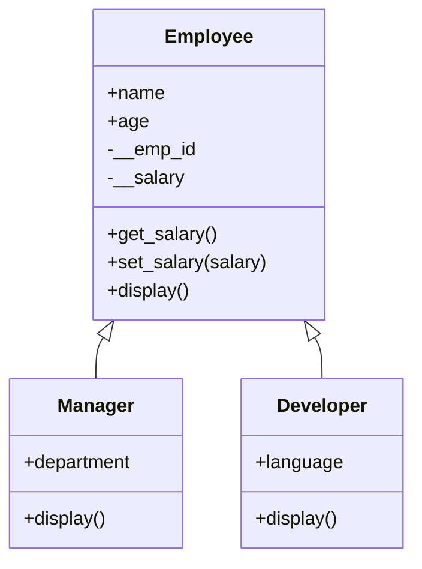
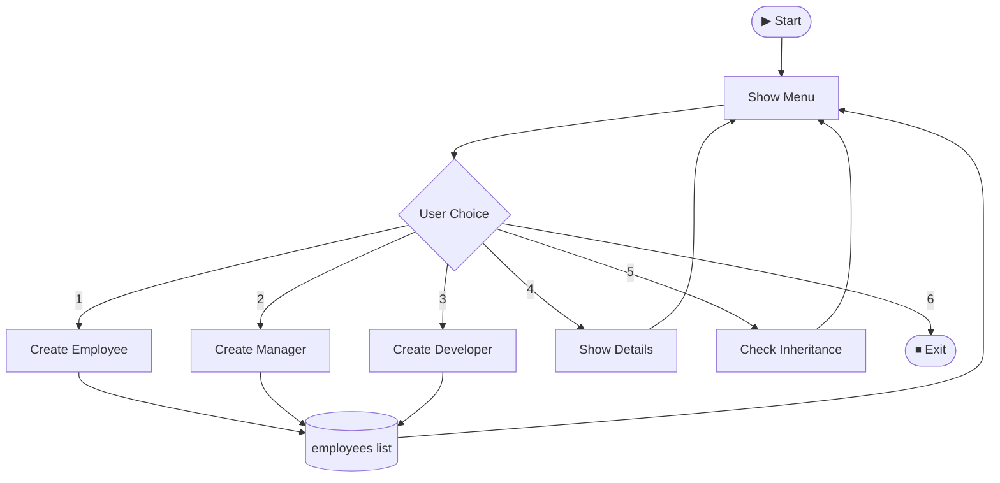

# OOP-Wrapper---Employee-Management-system

```
╔══════════════════════════════════════════════╗
║                                              ║
║     👔  EMPLOYEE MANAGEMENT SYSTEM  👨‍💻      ║
║            ~ OOP Wrapper ~                   ║
║                                              ║
╚══════════════════════════════════════════════╝
```


**A menu-driven Python program to create and manage Employees, Managers and Developers, built to demonstrate core Object-Oriented Programming concepts.**

</div>

---

## ✨ Features

| # | Menu Option | What It Does |
|:-:|-------------|--------------|
| 1 | 👤 Create Employee | Add a normal employee |
| 2 | 🧑‍💼 Create Manager | Add a manager with a department |
| 3 | 💻 Create Developer | Add a developer with a programming language |
| 4 | 📋 Show Details | Display all stored employees |
| 5 | 🔗 Check Inheritance | Verify subclass relationships with `issubclass()` |
| 6 | 🚪 Exit | Close the program |

---

## 🧠 OOP Concepts Covered

| Concept | Where It Is Used |
|---------|------------------|
| 🏗️ **Class & Object** | `Employee`, `Manager`, `Developer` |
| 🔒 **Encapsulation** | Private variables `__emp_id` and `__salary` |
| 🔑 **Getter / Setter** | `get_salary()` and `set_salary()` |
| 🧬 **Inheritance** | `Manager` and `Developer` extend `Employee` |
| ⬆️ **super()** | Call the parent constructor and `display()` |
| 🔁 **Method Overriding** | `display()` redefined in child classes |
| 🎭 **Polymorphism** | One `e.display()` call works for all employee types |

---

## 🌳 Class Diagram



---

## 🔄 Program Flow



---

## 🚀 How to Run

```bash
# 1. Check Python is installed
python --version

# 2. Run the program
python employee_management.py
```

> 💡 No external libraries needed. Pure Python!

---

## 🖥️ Sample Output

<details>
<summary><b>👉 Click to expand output</b></summary>

**Main Menu**
```
===================================
 Employee Management System
===================================

Choose an option:
1. Create Employee
2. Create Manager
3. Create Developer
4. Show Details
5. Check Inheritance
6. Exit
```

**Create Employee**
```
Enter Name: Jane
Enter Age: 22
Enter Employee ID: E101
Enter Salary: 25000
Employee Created Successfully!
```

**Create Manager**
```
Enter Name: Alice
Enter Age: 25
Enter Employee ID: M101
Enter Salary: 40000
Enter Department: Sales
Manager Created Successfully!
```

**Create Developer**
```
Enter Name: Raj
Enter Age: 23
Enter Employee ID: D101
Enter Salary: 35000
Enter Programming Language: Python
Developer Created Successfully!
```

**Show Details**
```
===== Employee Details =====

Name: Jane
Age: 22
Employee ID: E101
Salary: 25000
----------------------------

Name: Alice
Age: 25
Employee ID: M101
Salary: 40000
Department: Sales
----------------------------

Name: Raj
Age: 23
Employee ID: D101
Salary: 35000
Programming Language: Python
----------------------------
```

**Check Inheritance**
```
Manager is subclass of Employee: True
Developer is subclass of Employee: True
```

**Exit**
```
Exiting the system...
Thank You!
```

</details>

---

## 🗃️ Project Structure

```
📦 Employee-Management-System
 ┣ 📜 employee_management.py
 ┗ 📜 README.md
```

---


⭐ *If you liked this project, give it a star!* ⭐

